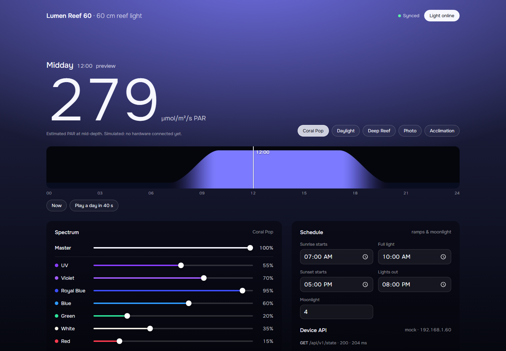
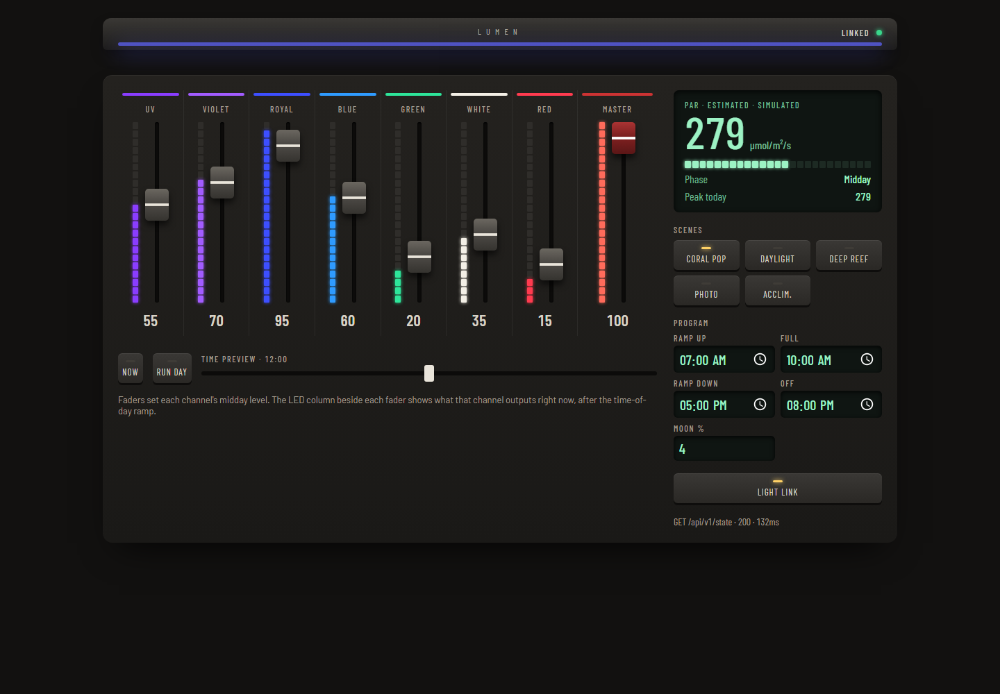

# Lighting_coraltank

Product design renders for a smart LED light for marine (coral reef) aquariums.

Key features:

- LED lights
- 60 cm tank
- Changing PAR
- Changing spectrum
- Changing time of day
- App control

## Control app (six styles)

A working concept of the light's control app, built before the hardware exists. Every version talks to the same **mock device API** in [`app/lumen-core.js`](app/lumen-core.js), shaped like the light's future Wi-Fi JSON endpoints. PAR values are simulated estimates.

Each version has: master brightness and PAR readout, 7 channel sliders (UV, Violet, Royal Blue, Blue, Green, White, Red), presets (Coral Pop, Daylight, Deep Reef, Photo, Acclimation), a 24 h schedule with sunrise/sunset ramps and moonlight, a time-of-day preview, and an offline simulation.

Run it locally, then open http://127.0.0.1:5173/ to compare all six:

```
python -m http.server 5173 --directory app
```

Add `?t=12` to any version's URL to preview that hour.

### 1 · Ambient
The whole screen is lit by the light; drag the day ribbon to preview any hour.


### 2 · Aluminium
Machined product feel; turn the ring around the lens to set master brightness.


### 3 · Swiss
Strict grid, huge numerals, a solid block of the current light color.


### 4 · Console
Lighting desk with a fader and live LED meter per channel.


### 5 · Almanac
A 24 h sun clock on sea-chart paper; drag the sun around the dial.


### 6 · Spectrometer
The emission spectrum is the hero, with each fader under its own wavelength.

