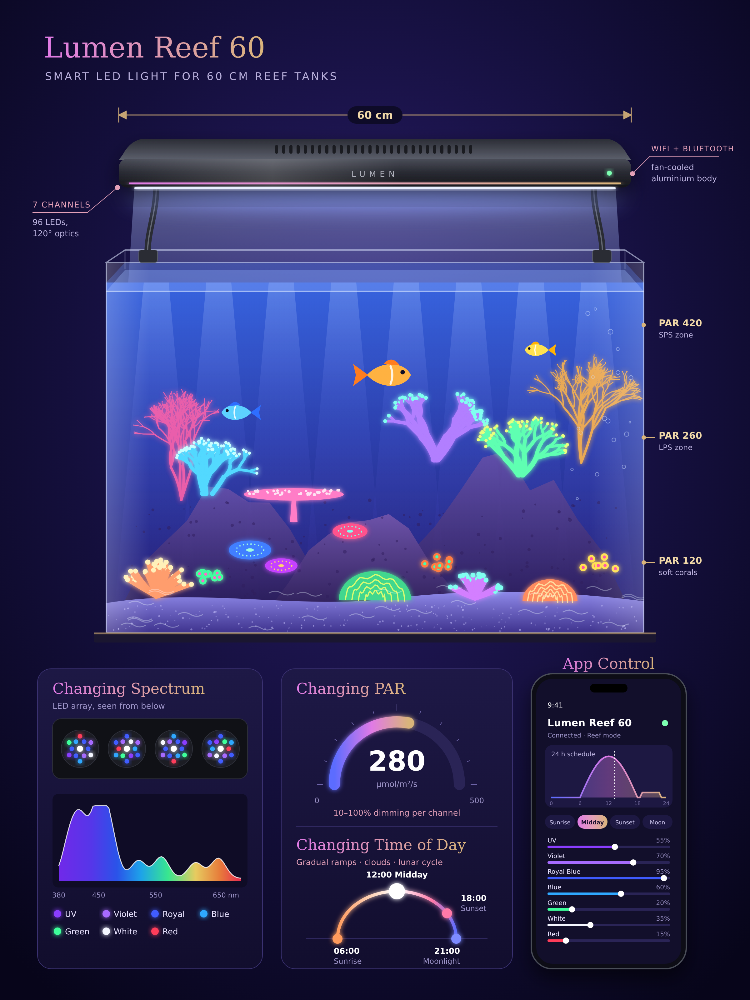
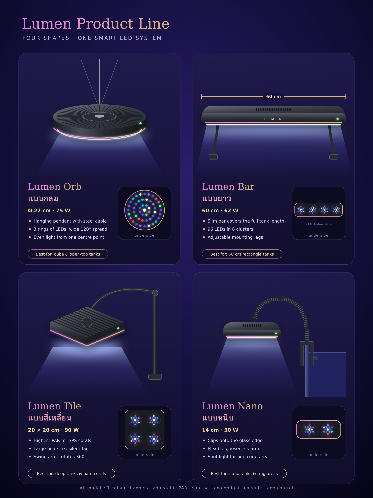

# Lighting_coraltank

Product design renders for a smart LED light for marine (coral reef) aquariums.

Key features:

- LED lights
- 60 cm tank
- Changing PAR
- Changing spectrum
- Changing time of day
- App control

## Lumen Reef 60: light over a 60 cm reef tank

- **Light bar:** a 60 cm aluminium bar with a fan, 7 colour channels and 96 LEDs.
- **Changing PAR:** light strength from 0 to 500 µmol/m²/s. The labels on the tank show PAR 420 near the top for SPS corals, 260 in the middle for LPS corals and 120 at the bottom for soft corals.
- **Changing spectrum:** the 7 channels are UV, Violet, Royal Blue, Blue, Green, White and Red.
- **Changing time of day:** sunrise at 06:00, midday at 12:00, sunset at 18:00 and moonlight at 21:00.
- **App control:** a 24-hour schedule, mode buttons and a slider for each colour channel.

## Product line: four shapes

| Model | Shape | Size and power | How it mounts | Best for |
|---|---|---|---|---|
| Lumen Orb | แบบกลม (round) | Ø 22 cm · 75 W | Hangs on a steel cable | Cube and open-top tanks |
| Lumen Bar | แบบยาว (long) | 60 cm · 62 W | Sits on legs on the tank | 60 cm rectangle tanks |
| Lumen Tile | แบบสี่เหลี่ยม (square) | 20×20 cm · 90 W | Swing arm that turns 360° | Deep tanks and hard corals |
| Lumen Nano | แบบหนีบ (clip-on) | 14 cm · 30 W | Clips onto the glass with a bendable arm | Small tanks and frag areas |

All four models have 7 colour channels, adjustable PAR, a sunrise-to-moonlight schedule and app control.

> The model names and specs are placeholders made up for the design.

## Files

| File | What it is |
|---|---|
| `render/lumen-reef-60.png` | Render of the light over the tank |
| `render/lumen-reef-60.html` | Source for that render |
| `render/lumen-lineup.png` | Render of the four product shapes |
| `render/lumen-lineup.html` | Source for that render |

To change a render, edit its HTML file and open it in a browser. The page is 1200×1600 px, so take a screenshot at 2× scale to get a 2400×3200 PNG.
